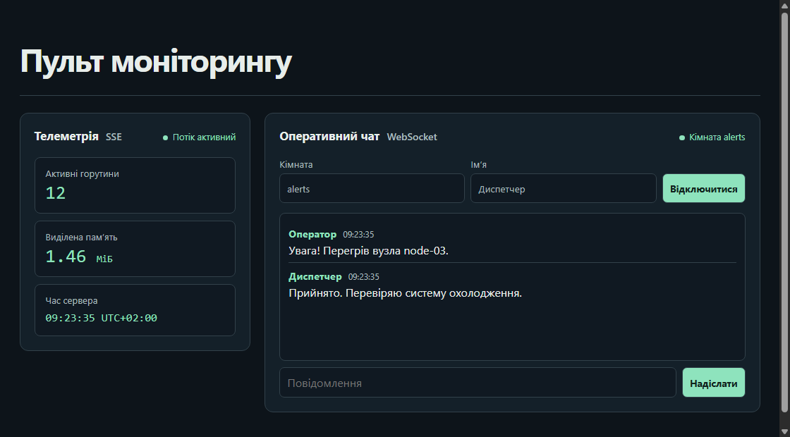

# Практична робота № 6. Комунікація в реальному часі

Go-сервіс моніторингу й оперативного зв’язку. Вебпанель отримує телеметрію сервера через SSE, а оператори обмінюються повідомленнями у своїх кімнатах через WebSocket.

## Запуск

Потрібні Go 1.22 або новіший і сучасний браузер. У PowerShell можна виконати ці команди з каталогу проєкту.

```powershell
go mod download
go run .
```

Відкрийте [http://localhost:8080](http://localhost:8080). Для іншого локального порту запустіть `go run . -addr 127.0.0.1:8090`. Завершити роботу сервера можна через `Ctrl+C`.

## Демонстрація

1. Відкрийте вебпанель у трьох вкладках. Перевірте, що час сервера в кожній вкладці оновлюється щосекунди.
2. У перших двох вкладках підключіться до `alerts` під різними іменами. У третій підключіться до `general`.
3. Надішліть повідомлення з першої вкладки. Воно з’явиться в обох вкладках `alerts`. Надішліть відповідь із другої вкладки. У `general` обох повідомлень не буде.
4. Надішліть повідомлення з `general` і перевірте, що його бачить лише учасник `general`.

Окремо потік SSE можна переглянути в терміналі. Ключ `-N` вимикає буфер виведення `curl`.

```powershell
curl.exe -N http://localhost:8080/api/v1/metrics/stream
```

Для перевірки WebSocket з термінала запустіть `wscat` у двох вікнах. Введений рядок надсилається як текст, а сервер повертає подію у JSON.

```powershell
wscat -c 'ws://localhost:8080/api/v1/ws?room=alerts&name=Operator'
wscat -c 'ws://localhost:8080/api/v1/ws?room=alerts&name=Dispatcher'
```

## Результати перевірки

Три вкладки Chrome одночасно отримували SSE. Оператор і диспетчер обмінялися повідомленнями в `alerts`, а в `general` відобразилося лише повідомлення чергового. Перевірка в Chrome також підтвердила відключення, повторний вхід до іншої кімнати та відсутність помилок у консолі браузера під час цього сценарію.

| Вкладка | Результат |
| --- | --- |
| [`alerts` · Оператор](docs/screenshots/alerts-operator.png) | Отримав свою подію та відповідь диспетчера. |
| [`alerts` · Диспетчер](docs/screenshots/alerts-dispatcher.png) | Отримав повідомлення оператора й надіслав відповідь. |
| [`general` · Черговий](docs/screenshots/general.png) | Отримав повідомлення своєї кімнати. |



```powershell
go test -v ./...
go vet ./...
go build .
```

Чотири автоматичні тести пройшли три послідовні запуски. Вони перевіряють заголовки та формат SSE, скасування потоку, HTTP Upgrade, кімнату за замовчуванням, ізоляцію чатів, Ping/Pong і віддачу вебсторінки. У тесті Heartbeat інтервали скорочені, щоб перевірка швидко відтворювала відключення клієнта без Pong. Під час окремого запуску `curl.exe -N` три події SSE надійшли з інтервалом в одну секунду.

## Як працює сервіс

- `GET /api/v1/metrics/stream` щосекунди надсилає `time` у форматі RFC 3339, `goroutines` і `alloc_mb`. Значення `alloc_mb` обчислюється в МіБ із `runtime.MemStats.Alloc`. Обробник викликає `Flush()` для кожної події та зупиняє таймер при скасуванні запиту.
- `GET /api/v1/ws?room=alerts&name=Operator` оновлює HTTP-з’єднання до WebSocket. Без `room` клієнт потрапляє в `general`, а без `name` підписом є адреса з’єднання. Назва кімнати має містити 1–32 латинські літери, цифри, дефіси або підкреслення.
- `Hub.Run` володіє списками учасників кімнат і через канали Go обробляє реєстрацію, вихід і розсилку. Клієнт надсилає текстовий фрейм, а Hub розсилає JSON з полями `room`, `sender`, `text` і `time` учасникам кімнати, включно з відправником. Буфер клієнта вміщує 256 повідомлень. Якщо він заповнюється, Hub відключає цього клієнта, щоб інші учасники продовжили отримувати події.
- `readPump` читає повідомлення та обробляє Pong. `writePump` послідовно пише повідомлення й кожні 40 секунд надсилає Ping. Після підключення та кожного Pong клієнт має 60 секунд до дедлайну читання. Після спливу дедлайну Hub видаляє клієнта й закриває сокет.
- Go-сервер віддає вбудовані файли з `web/`. Браузер використовує `EventSource` для метрик та `WebSocket` для чату. За умовою лабораторного прикладу WebSocket приймає з’єднання з різних джерел (`Origin`). Сервер за замовчуванням слухає локальну адресу.

## Контрольні питання

1. **Чим відрізняються SSE і WebSocket?** SSE передає текстові події від сервера до клієнта в потоковій HTTP-відповіді. Через WebSocket обидві сторони можуть незалежно надсилати текстові й двійкові фрейми після встановлення з’єднання.
2. **Що робить `http.Flusher`?** Він змушує Go HTTP-сервер відправити буферизовані дані, залишаючи відповідь відкритою для наступних подій.
3. **Що станеться без перевірки `r.Context().Done()`?** Цикл може залишатися активним після відключення клієнта, доки запис не поверне помилку. Скасування контексту дозволяє одразу завершити очікування події та зупинити таймер.
4. **Як відбувається рукостискання?** Клієнт надсилає HTTP-запит із `Upgrade: websocket`, `Connection: Upgrade`, ключем і версією. Сервер перевіряє запит і повертає `101 Switching Protocols` із `Sec-WebSocket-Accept`, обчисленим на основі ключа. Після цього сторони обмінюються фреймами WebSocket.
5. **Як забезпечується послідовний запис?** Gorilla дозволяє один одночасний виклик операцій звичайного запису на з’єднанні. Hub ставить повідомлення в чергу `send`, звідки їх записує одна горутина `writePump`.
6. **Навіщо дві горутини на з’єднання?** Блокуюче читання від клієнта може тривати одночасно з відправленням повідомлень чи Ping. `readPump` та `writePump` виконують ці операції незалежно.
7. **Як Heartbeat виявляє обрив?** Сервер періодично надсилає Ping. Кожен отриманий Pong продовжує дедлайн читання. Коли дедлайн спливає, читання повертає помилку, і з’єднання закривається.
8. **Що дає `EventSource`?** Він забезпечує простий прийом текстових подій і автоматичне перепідключення браузера. Для двосторонньої передачі або двійкових даних підходить `WebSocket`, де перепідключення застосунок реалізує самостійно.

Джерела для контрольних питань. [WHATWG HTML](https://html.spec.whatwg.org/multipage/server-sent-events.html), [RFC 6455](https://www.rfc-editor.org/rfc/rfc6455), [документація Gorilla WebSocket](https://pkg.go.dev/github.com/gorilla/websocket).
